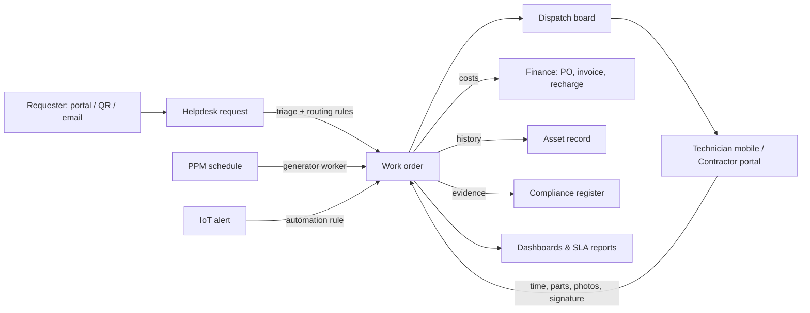

# 04 · Architecture & Tech Stack

## Guiding principles

1. **Modular monolith first.** One deployable API with strict module boundaries. Split out services only when there is a measured need (e.g. IoT ingestion, reporting). This keeps development fast for a small team while staying scalable.
2. **Configuration over code.** Fields, forms, workflows, permissions and SLAs are data, not code, so the Super User can change them and every module benefits.
3. **Multi-tenant by default, isolated by design.** Every row carries `tenant_id`, enforced by PostgreSQL row-level security (RLS) as a second line of defence behind the application.
4. **API-first.** The web app and mobile app use the same public, versioned API that customers use.
5. **TypeScript end to end.** Shared types and validation between front end, back end and mobile.
6. **Portable infrastructure.** Containers, Postgres, Redis and S3-compatible storage, so we can run on Railway early and AWS (London region) for enterprise without rewrites.

## Stack (recommended)

| Layer | Choice | Why |
|-------|--------|-----|
| Monorepo | **pnpm workspaces + Turborepo** | Shared packages, fast cached builds |
| Web front end | **Next.js (App Router) + React + TypeScript** | SSR for the portal and login, rich client app for back office |
| UI | **Tailwind CSS + shadcn/ui (Radix)**, TanStack Table/Query, React Hook Form + Zod | Accessible components, fast data grids, shared validation |
| Charts/maps/plans | Apache ECharts, MapLibre GL + OpenStreetMap, SVG floor-plan viewer; That Open Engine (web-ifc) for IFC | Open source, no per-seat fees |
| API | **NestJS (Node.js, TypeScript)**, REST + OpenAPI 3.1 | Modules, DI, guards for permissions, generated API docs |
| ORM / migrations | **Prisma** (with raw SQL for RLS policies and reporting views) | Type-safe, good migration tooling |
| Database | **PostgreSQL 16+** with PostGIS, `pg_trgm`, JSONB | Relational core, geo, fuzzy search, custom fields |
| Cache / queues | **Redis + BullMQ** | Background jobs: PPM generation, notifications, imports, SLA timers, webhooks |
| Search | Postgres full-text search (phase 1) → Meilisearch/OpenSearch (when needed) | Start simple |
| Files | S3-compatible object storage, presigned uploads, ClamAV scanning, image thumbnails | Scalable, cheap |
| Realtime | WebSockets (Socket.IO) / SSE | Dispatch board, live SLA counters, notifications |
| PDF | Headless Chromium (Playwright) rendering HTML templates | Branded job sheets and reports |
| Email | Transactional provider (e.g. Postmark/SES) + inbound parsing for email-to-ticket | Reliable delivery, inbound routing |
| SMS / push | Twilio (SMS), Web Push + FCM/APNs | Alerts |
| Mobile | **PWA first** (offline via service worker + IndexedDB), then **React Native (Expo)** sharing TS packages | Fast to ship, native later |
| Auth | In-house session auth (Argon2id hashing, httpOnly secure cookies, CSRF protection), TOTP + WebAuthn MFA; SAML/OIDC later via a library (or WorkOS) | Simple now, enterprise-ready later |
| Billing | **Stripe Billing** + in-house entitlements service | Subscriptions, seats, usage, invoices, VAT |
| AI | LLM API (vision + text) behind an internal AI gateway; pgvector for retrieval | Triage, OCR, Q&A with permission-aware retrieval |
| Observability | OpenTelemetry → logs/metrics/traces (e.g. Grafana stack or Sentry + hosted provider), uptime checks | |
| Testing | Vitest, Playwright e2e, Supertest API tests, k6 load tests | See doc 09 |
| CI/CD | GitHub Actions → container images → Railway (staging/demo/prod) | Preview environments per PR |

## Repository layout

```
/apps
  /web          Next.js: login, back office, requester portal, contractor portal
  /api          NestJS: REST API, auth, modules
  /worker       BullMQ workers: schedules, notifications, imports, PDFs, webhooks, AI jobs
  /mobile       (Phase 5) Expo React Native app
/packages
  /db           Prisma schema, migrations, RLS policies, seed + demo data
  /shared       Zod schemas, DTO types, permission constants, enums
  /ui           Shared React component library and design tokens
  /config-engine  Custom fields, form schema, workflow state machine runtime
  /sdk          Typed API client (used by web, mobile and customers)
/docs           Plans, ADRs, API guides
/infra          Dockerfiles, Railway/AWS config, IaC
```

## Multi-tenancy

- **Shared database, shared schema**, `tenant_id` on every tenant-owned table.
- Each request sets `SET app.tenant_id = …` inside its transaction; **RLS policies** restrict all queries to that tenant. Platform-admin access uses a separate DB role and is audited.
- Tenant resolved from the session (and custom domain/subdomain for portals).
- File storage keys prefixed by tenant; presigned URLs checked against permissions.
- **Enterprise options**: dedicated database (same code, different connection) and **data residency** (UK vs EU region).
- FM-provider edition adds an in-tenant **client** dimension (`client_id`) used for data scoping, branding and reporting.

## Configuration engine (the heart of "Super User can change anything")

- **Entity metadata registry**: every entity type declares its system fields; tenants add custom fields stored in a typed JSONB `custom` column, with definitions in `field_definition`. Indexed via GIN and expression indexes for commonly filtered fields.
- **Form schemas**: JSON layout definitions per entity/type/role, rendered by a shared form renderer on web and mobile.
- **Workflow runtime**: per-tenant state machines (`workflow_definition` with states, transitions, guards, required fields, actions). Every status change goes through it, so validation is identical in UI, API and import.
- **Automation engine**: event bus (transactional **outbox** table → worker) evaluates rules (trigger, conditions, actions) with loop protection and run logs.
- **SLA engine**: business-calendar-aware timers; computed due dates stored on records; worker re-evaluates on pause/resume and fires escalation events.
- **Versioning**: every config object is versioned; changes produce audit diffs and can be rolled back; config packages exportable as JSON.

## Entitlements & feature gating

- `plan` → set of **entitlements** (feature keys, limits such as max sites/assets/users, AI credits).
- Tenant overrides (trials, custom deals) and add-ons layered on top.
- One `can(tenant, feature)` check, used in API guards, UI (hide or show upgrade prompts) and workers.
- Usage meters (seats by licence type, assets, storage, SMS, AI credits) recorded for billing and limits.
- Built in Phase 0 so every module is gated from day one; Stripe sync added in Phase 5.

## Key flows



## Integrations architecture

- **Outbound**: webhooks (signed, retried with exponential backoff, delivery log); connector workers per integration with per-tenant credentials encrypted (envelope encryption, KMS).
- **Inbound**: public API with OAuth2/API keys; email inbound; IoT ingestion endpoint (separate service when volume demands it, writes to a time-series table using TimescaleDB or partitioned Postgres).
- **Idempotency keys** on all write APIs; cursor pagination; rate limiting per tenant and key.

## Hosting & environments

| Environment | Purpose | Notes |
|-------------|---------|-------|
| Local | Dev | Docker Compose: Postgres, Redis, MinIO, Mailpit |
| Preview | Per-PR | Ephemeral, seeded demo data |
| Staging | Pre-release | Production-like |
| **Demo** | Public sales demo | Demo credentials on login page, **reset nightly** |
| Production | Customers | UK region; PITR backups; later AWS eu-west-2 for enterprise/ISO |

Early hosting on **Railway** (managed Postgres, Redis, buckets, per-PR environments) for speed; everything is containerised so it moves to AWS (ECS/RDS/ElastiCache/S3) when enterprise contracts require it.

## Architecture Decision Records

Record significant decisions in `/docs/adr/NNNN-title.md` (context, decision, consequences). Initial ADRs to write in Phase 0:
1. Modular monolith with NestJS + Next.js.
2. Shared-schema multi-tenancy with Postgres RLS.
3. JSONB custom fields with metadata registry.
4. In-house session auth now, SSO later.
5. PWA-first mobile.
6. Entitlements model independent of Stripe.
