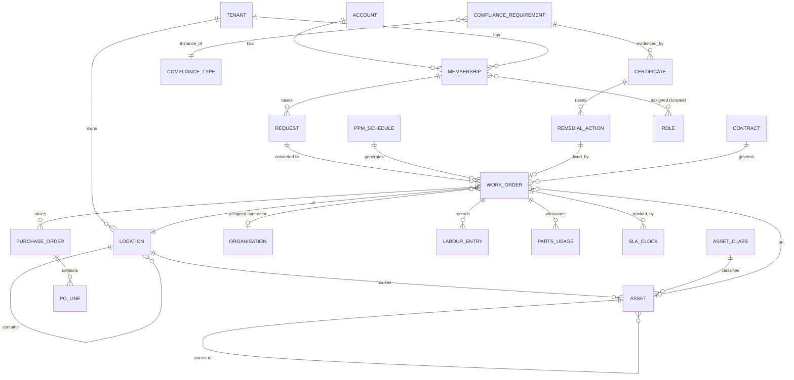

# 05 · Data Model (Core Entities)

The conceptual model. Physical schema lives in `packages/db/prisma/schema.prisma`. Conventions:

- Every tenant-owned table has `id` (UUID v7, generated in the application because Postgres only gains a native `uuidv7()` in version 18), `tenant_id`, `created_at/by`, `updated_at/by`, `deleted_at` (soft delete), `version` (optimistic locking), and `custom` (JSONB custom fields) where configurable.
- Money is stored as integer minor units + currency code. Times are stored in UTC; site time zone is applied for SLA calculations.
- Human-friendly references (`WO-000123`) come from per-tenant sequences.

## Platform & identity

| Entity | Key fields / notes |
|--------|--------------------|
| `tenant` | name, slug, status (trial/active/suspended), plan, region, branding, settings |
| `plan`, `entitlement`, `tenant_entitlement_override`, `addon_subscription` | feature keys and limits |
| `usage_meter` | tenant, meter key, period, quantity |
| `account` | **global (not tenant-scoped)**: email (globally unique, nullable for username-only accounts), name, password hash, MFA factors, locale, display preferences (a JSON object of the person's own choices, such as a collapsed side menu, so they follow them across devices and organisations) |
| `membership` | account × tenant: status, licence_type, username (unique per tenant, optional), default site, time zone, landing page. Most "user" references in other tables point at `membership` |
| `session`, `oauth_token`, `mfa_factor`, `password_reset`, `sso_connection`, `terms_acceptance` | auth |
| `role`, `permission`, `role_permission`, `membership_role` (with scope) | RBAC + scope |
| `support_access_grant` | vendor support access requests: tenant approval, expiry, audit |
| `subscription`, `billing_invoice`, `feature_flag` | mirror of Stripe state; internal feature flags |
| `team`, `team_member` | groups for assignment and scoping |
| `organisation` | contractor companies, suppliers, clients (type flag) |
| `api_key`, `oauth_client`, `webhook_endpoint`, `webhook_delivery` | integration |
| `audit_event` | actor, action, entity, before/after diff, ip, user agent (append-only, partitioned by month) |

## Configuration

| Entity | Notes |
|--------|-------|
| `field_definition` | entity type, key, type, options, validation, visibility rules |
| `form_layout` | entity type, sub-type, role, JSON layout |
| `workflow_definition`, `workflow_state`, `workflow_transition` | per entity type |
| `automation_rule`, `automation_run` | trigger/conditions/actions JSON, logs |
| `sla_policy`, `sla_target`, `business_calendar`, `holiday` | |
| `priority`, `category`, `problem_code` | request catalogue |
| `numbering_sequence`, `picklist`, `term_override`, `notification_template` | |
| `saved_view`, `dashboard`, `dashboard_widget`, `report_definition`, `report_schedule` | user/shared views and reports |
| `notification`, `notification_preference`, `announcement`, `knowledge_article` | communications |
| `import_job`, `export_job`, `record_link`, `tag`, `legal_hold`, `retention_policy` | platform services |
| `inbound_mailbox` | email-to-ticket addresses and routing |
| `config_version` | snapshot/diff of any config object |

## Estate & assets

| Entity | Notes |
|--------|-------|
| `location` | tree (ltree path or closure table), level type, address, geo (PostGIS), area, calendar |
| `floor_plan`, `space` | plan file, SVG, space polygons, room type, capacity, department |
| `asset_class` | classification code (Uniclass/NRM/SFG20/custom), attribute template |
| `asset` | class, location, parent asset, make/model/serial, install date, criticality, condition, status, warranty, tags |
| `asset_tag` | QR/barcode/NFC values |
| `meter`, `meter_reading` | asset or location meters |
| `condition_survey`, `survey_item`, `defect` | |
| `document`, `document_version`, `document_link` | linked to any entity |

## Work management

| Entity | Notes |
|--------|-------|
| `request` | requester, channel, category, location, asset, description, priority, status |
| `work_order` | type (reactive/PPM/project/inspection), status, priority, location, asset, assignee(s), contractor org, SLA due dates, NTE, costs, client/contract |
| `work_order_task`, `checklist_response` | steps and form answers |
| `labour_entry`, `parts_usage`, `expense` | costs |
| `ppm_task_template`, `ppm_schedule`, `ppm_schedule_asset` | frequency, rules, next due |
| `quote`, `quote_line` | |
| `comment`, `attachment`, `signature`, `activity` | polymorphic link to any entity |
| `sla_clock` | per record: target type, due, paused intervals, breached_at |
| `qualification`, `training_record`, `shift`, `availability`, `leave`, `timesheet` | workforce |
| `inspection_round`, `round_checkpoint` | building rounds |
| `outage` | planned shutdowns and affected assets/spaces |
| `asset_serves` | asset → spaces/assets it serves |

## Compliance & safety

| Entity | Notes |
|--------|-------|
| `compliance_type` | template (legislation ref, frequency, evidence required) |
| `compliance_requirement` | type × location/asset, responsible, contractor, next due |
| `certificate` | file, issue/expiry, result, extracted data |
| `remedial_action` | from certificate/inspection/audit, severity, linked work order |
| `inspection_template`, `inspection`, `inspection_answer` | audits |
| `incident`, `investigation`, `capa_action`, `risk`, `risk_assessment`, `rams`, `permit` | |

## Commercial

| Entity | Notes |
|--------|-------|
| `contract`, `contract_sla`, `kpi`, `kpi_result`, `deduction` | |
| `accreditation`, `insurance_policy` | for organisations |
| `part`, `store`, `stock_level`, `stock_movement`, `kit`, `tool`, `calibration` | inventory, tools and test equipment |
| `requisition`, `purchase_order`, `po_line`, `goods_receipt`, `supplier_invoice` | procurement |
| `cost_centre`, `budget`, `budget_line`, `rate_card`, `sor_item` | finance |
| `client_invoice`, `client_invoice_line` | billing (FM providers) |

## Workplace, energy, real estate, other

`booking`, `bookable_resource`, `visitor`, `visit`, `move_request`, `utility_meter`, `consumption`, `utility_bill`, `emission_factor`, `carbon_record`, `waste_record`, `property`, `lease`, `lease_event`, `rent_schedule`, `service_charge`, `project`, `project_task`, `capital_request`, `vehicle`, `key`, `key_issue`, `device`, `telemetry` (time-series), `alert_rule`, `alert`, `survey`, `survey_response`, `insurance_claim`, `lost_property`, `hazard_case` (housing: Awaab's Law/HHSRS), `void`, `ai_interaction`, `support_ticket`.

## Tables without row-level security

Every tenant-owned table has `tenant_id` and row-level security (RLS) policies (CLAUDE.md). Three tables carry a `tenant_id` and have RLS **off**, on purpose. `packages/db/test/rls.test.ts` fails if any other table does, so this list cannot grow by accident.

| Table | Why it has no RLS | Rule for code that uses it |
| --- | --- | --- |
| `session` | A session is found by the hash of its token, before any organisation is known, so there is no tenant context to filter by. | Look it up only by token hash. Delete only by session, device or account id. Never list sessions in a tenant context without filtering on `tenant_id`. |
| `auth_event` | It also records sign-ins that have no organisation (a failed attempt, a person with several organisations), so `tenant_id` can be empty. | Written by the API. Nothing reads it today. Anything that ever reads it must filter on `tenant_id` itself. |
| `captured_email` | Email that was captured instead of sent: always for demo organisations (doc 06), and for any organisation while no mail server is configured. The worker writes it from a background job, not from a request. | Written by the email worker and cleared by the nightly demo reset. Nothing reads it today. Anything that ever reads it must filter on `tenant_id` itself. |

Other things worth knowing when reading the schema:

- **Tables with no `tenant_id` by design.** `account`, `oauth_code`, `mobile_device` and the other account tables belong to a person, not an organisation: one person can belong to several. They are reached by account id (`withAccount`), not by tenant.
- **`FORCE ROW LEVEL SECURITY` is not set.** The API connects as `cafm_app`, which owns nothing and cannot bypass policies. The owner role `cafm` (migrations, seed, the platform CLI) does bypass them. That is why the API must never be pointed at the owner role.

## Relationship overview

