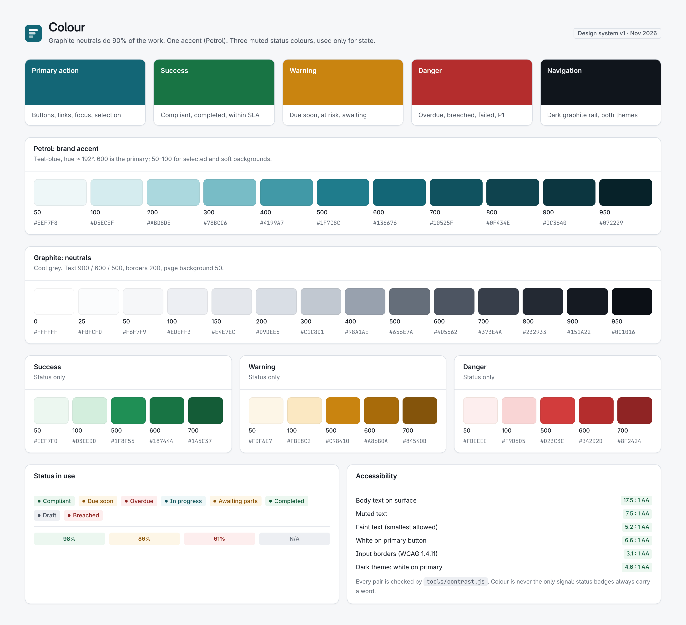
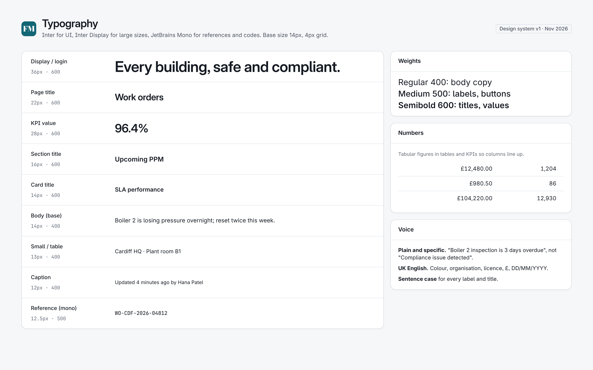
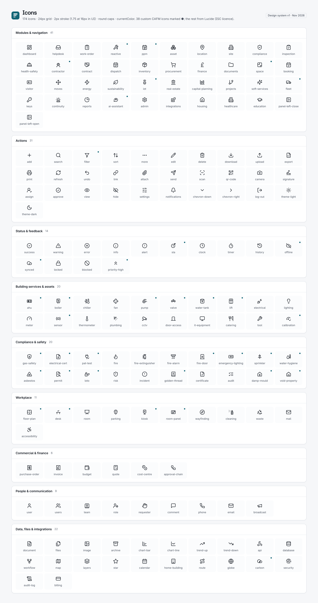
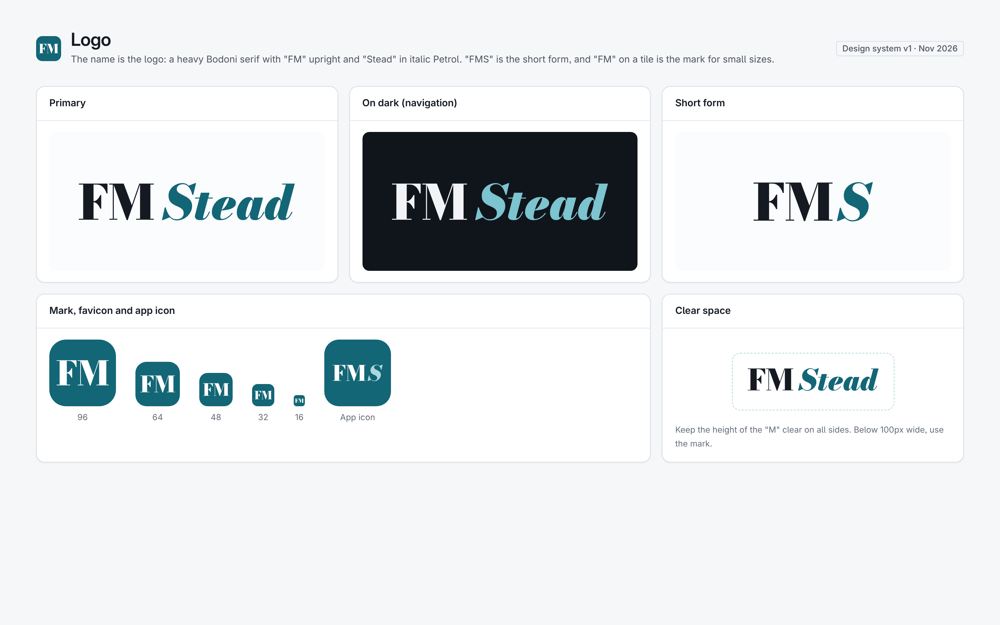
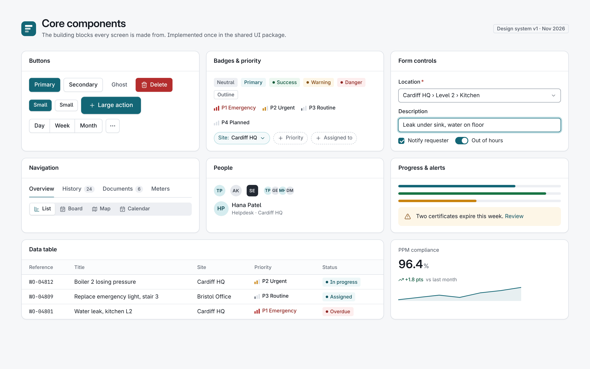

# 11 · Design System

> Source files: [`design/`](../../design). Tokens: [`design/tokens/tokens.css`](../../design/tokens/tokens.css) and [`tokens.json`](../../design/tokens/tokens.json). Icons: [`design/icons/`](../../design/icons). Every screen: [12-screen-catalogue](12-screen-catalogue.md).

## Direction: professional, premium, restrained

The brief: look professional and premium, and don't overcomplicate with lots of colours. The design answers that with three rules:

1. **Neutrals do 90% of the work.** A cool graphite grey scale carries text, surfaces, borders and the dark navigation rail.
2. **One accent colour ("Petrol").** It is used for brand, primary actions, links, focus and selection, and nothing else.
3. **Status colours are muted and used only for state.** Green, amber and red mean compliant, due/at risk, and overdue/failed, and always come with a word, never colour alone.

Charts follow the same rule: they use Petrol shades and greys, and green, amber and red appear in a chart only when the chart shows status.

## Colour research

| Finding | Implication |
|---------|-------------|
| Blue is the default trust colour in B2B software, but it is so widely used that it stops distinguishing a product | Avoid plain mid-blue, which most CAFM/CMMS competitors use |
| Teal is described as combining blue's stability with green's growth signal, and a green-leaning teal as reading "technical" | A deep teal-blue fits buildings, sustainability and engineering |
| 2026 SaaS direction: neutral base, one restrained accent, tonal palettes, colour reserved for status and data, less chrome | Single-accent system; separate rules for chart colours |
| Test palettes in both light and dark themes; never use colour as the only status signal | Contrast checker in the repo; dark theme from day one |

Sources: [SkyRye Design](https://skyryedesign.com/?p=116957) · [Inkbot Design](https://inkbotdesign.com/colour-psychology/) · [Kalungi](https://www.kalungi.com/blog/choosing-branding-colors-for-your-b2b-saas-company) · [Focus Lab](https://focuslab.agency/blog/color-your-b2b-tech-brand-with-the-right-shade-and-message) · [ToolsJam colour trends 2026](https://toolsjam.co/blog/color-trends-2026) · [TheKitBase SaaS dashboard trends 2026](https://dev.to/thekitbase/saas-dashboard-design-trends-in-2026-with-examples-121m) · [AdminLTE dashboard colour schemes](https://adminlte.io/blog/best-admin-dashboard-color-schemes/). A search for competitors' exact brand colours (MaintainX, UpKeep, Limble, Planon) found no published values; checking their brand assets is a follow-up for the branding exercise (D6).

The research is directional: most of it comes from design agencies and template vendors. Validate the palette with design partners in Phase 1, as recommended in [doc 10](10-risks-and-decisions.md).

**Decision: Graphite + Petrol.** Petrol (`#136676`, hue ≈ 192°) is a deep teal-blue. It sits between the trust of navy and the "buildings and sustainability" signal of teal. It is distinct from competitors' blues, and different enough from the status green that the two are never confused. The dark graphite navigation rail gives a premium, focused frame.

## Palette



| Role | Token | Light | Dark |
|------|-------|-------|------|
| Page background | `--bg-app` | `#F6F7F9` | `#0B0F14` |
| Card / surface | `--bg-surface` | `#FFFFFF` | `#12171E` |
| Text | `--text` | `#151A22` | `#E8EBEF` |
| Muted text | `--text-muted` | `#4D5562` | `#A3ACB8` |
| Faint text (smallest allowed) | `--text-faint` | `#656E7A` | `#7C8693` |
| Border | `--border` | `#D9DEE5` | `#252D38` |
| Form-control border | `--border-control` | `#8A93A0` | `#606A77` |
| Primary (Petrol 600) | `--primary` | `#136676` | `#2A8090` |
| Success / warning / danger | `--success` etc. | `#187444` / `#C98410` / `#B42D2D` | lighter equivalents |
| Navigation rail | `--nav-bg` | `#10151C` | `#080B0F` |

**Accessibility:** every text/background pair meets WCAG 2.2 AA (4.5:1), and control borders meet the 3:1 non-text rule. `design/tools/contrast.js` checks all pairs and fails if any regress. Two first-draft values failed and were fixed before the mockups were rendered: faint text on the page background, and input borders.

Tenants can change the accent colour (white-label, [doc 03](03-roles-permissions-admin.md)). The branding screen rejects accents that fail contrast with white text.

## Typography



- **Inter** for UI (14px base, 4px grid); **Inter Display** for titles and KPI numbers; **JetBrains Mono** for references (`WO-CDF-04812`) and codes.
- Tabular figures in all tables and KPIs.
- Sentence case everywhere; UK English; plain, specific wording ("Boiler 2 inspection is 3 days overdue").

## Icons



- **174 icons** in 9 categories: Lucide (ISC licence, free for commercial use) plus **38 custom CAFM icons** drawn on the same 24px grid with 2px round strokes. The custom set covers boiler, AHU, lift, pump, valve, legionella, asbestos, gas safety, EICR, PAT, fire door, emergency lighting, sprinkler, permit to work, lock-out/tag-out, golden thread, damp and mould, void property, floor plan, desk, kiosk, room panel, IoT, SLA and others.
- Files: one SVG per icon in `design/icons/svg/` (uses `currentColor`), a `<symbol>` sprite in `design/icons/sprite.svg`, and a manifest in `design/icons/icons.json`.
- Icons next to text are decorative (`aria-hidden="true"`). Icon-only buttons need an accessible label. Status is never shown by an icon or colour alone.
- Use 16px in tables, buttons and menus (1.75 stroke), 18px in the top bar, 20–24px on mobile. Use the muted text colour by default, the primary colour when active, and status colours only when showing status, always with text.
- Sheets: [full set](../../design/mockups/png/ds-06-icons.png) · [dark](../../design/mockups/png/ds-07-icons-dark.png) · [custom icons at construction size](../../design/mockups/png/ds-08-icons-custom.png) · [usage](../../design/mockups/png/ds-09-icons-usage.png).

## Logo



The name is the logo. "FM" is set upright in graphite and "Stead" in italic Petrol, in Bodoni Moda Black. "FMS" is the short form for tight spaces, and "FM" on a Petrol tile is the mark for the favicon, the side menu and other small sizes. The letters are outlines, so no font is needed to draw them (Bodoni Moda is licensed under the SIL Open Font License 1.1). The colours are tokens only: graphite-900 and petrol-600, and in the dark theme the navigation text colour and the dark primary text colour. The tile in the mark follows the tenant's accent colour.

Files are in `design/icons/logo/`. `npm run icons` generates them from `design/tools/logo.js`, and `Logo` in `packages/ui` draws the same mark. The interface itself stays in Inter. The side menu and the sign-in pages show the wordmark (`Wordmark` in `packages/ui`), and the collapsed menu rail shows the "FM" tile.

## Components and layout



- **Shell:** 248px dark navigation rail (collapsible to 64px), 56px top bar with breadcrumbs, ⌘K search, AI assistant and notifications. The page has 32px side padding and content up to 1440px.
- **Core components:** buttons (primary, secondary, ghost, danger), badges and status pills, priority indicator (bars plus label), filter chips, segmented controls, tabs, data table with bulk actions, KPI tile with sparkline, card, description list, timeline, callout, stepper, kanban, planner grid, floor plan, map, modal, drawer, command palette.
- **Navigation badges:** a neutral count shows items waiting for action (unassigned requests); a red count shows overdue items (overdue work orders, compliance).
- **States:** every list and page uses the shared empty, loading, error, no-permission, plan-locked, offline and toast patterns ([states sheet](../../design/mockups/png/ds-10-states.png)).
- **Radius:** 4 badges · 6 controls · 8 menus · 12 cards · 16 modals. **Elevation:** four subtle shadows.
- **Mobile:** 50px buttons, 16px card radius, bottom tab bar, offline status always visible.
- **Implementation:** `packages/ui` React components using the mockups' own component stylesheet (`design/mockups/src/styles.css`, built on `tokens.css`), with Radix primitives for complex behaviour ([ADR 0009](../adr/0009-shared-component-stylesheet.md)).

## How the build uses this

1. **Phase 0:** import the shared component stylesheet (and so `tokens.css`) into the web app through `packages/ui`. Build the shell, the components above and the state patterns in `packages/ui`, and match them against the mockups.
2. **Each module:** start from its screens in the [screen catalogue](12-screen-catalogue.md) and keep the layout, hierarchy and components. Where real requirements differ, update the mockup source and re-render, so the catalogue stays the single picture of the product.
3. **Visual regression:** Playwright screenshots of built screens can be compared with the mockups during review.

## Regenerating

```bash
cd design
npm install
npm run icons      # SVGs, sprite, manifest, tokens.json
npm run render     # all screens → HTML + PNG (then compresses PNGs)
npm run contrast   # WCAG contrast check
npm run validate   # icon references, SVG structure, screen ids
node tools/catalogue.js   # rebuilds docs/plan/12-screen-catalogue.md
```
